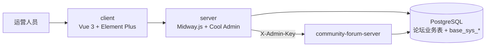

# Community Forum Admin — 社区论坛管理后台

> 社区论坛的运营管理后台，在开源框架 [Cool Admin](https://cool-js.com)（Midway.js + Vue 3）之上开发 `forum` 业务模块，直接对接论坛后端 [community-forum-server](../../../community-forum-server) 的数据库与后台接口。


[](server/LICENSE)

## 本仓库自研部分

框架代码来自 Cool Admin（MIT，© 厦门闪酷科技开发有限公司，许可证见 `client/LICENSE`、`server/LICENSE`）。本仓库新增的论坛业务集中在两个目录：

| 位置 | 内容 |
| --- | --- |
| `server/src/modules/forum/` | 14 个后台控制器、13 个实体：用户、帖子、分类、公告、广告位、悬赏、赞赏、积分流水、商城道具、装扮、站内通知、数据看板、内容同步 |
| `client/src/modules/forum/` | 对应的管理页面：列表 / 详情 / 配置 / 数据看板 |

## 亮点

- **与论坛后端共用数据库**：论坛表由后端的 Prisma 迁移管理，后台实体统一声明 `@Entity({ synchronize: false })`，避免 TypeORM 自动同步改动业务表；Cool Admin 自身的 `base_sys_*` 表照常同步（`server/src/config/config.local.ts`）。
- **服务间调用**：需要业务校验的写操作调用论坛后端 `/api/admin/*`，以 `X-Admin-Key` 头鉴权。
- **数据看板**：积分发放与回收、按类型分布、赞赏流水等运营指标汇总（`forum/service/dashboard.ts`）。
- **自动化构建**：GitHub Actions 构建并推送前后端镜像（`.github/workflows/build.yml`）；附菜单图标一致性检查脚本（`scripts/check-menu-icons.mjs`）。

## 架构



## 目录结构

```
├── client/                 # 前端（Cool Admin Vue）
│   └── src/modules/forum/  # 论坛管理页面（自研）
├── server/                 # 后端（Cool Admin Midway）
│   └── src/modules/forum/  # 论坛后台控制器 / 实体 / 服务（自研）
├── scripts/                # 菜单图标检查
└── .github/workflows/      # 镜像构建
```

## 快速开始

前置：Node.js 20+、pnpm、PostgreSQL（与论坛后端同库）。

```bash
# 后端
cd server
pnpm install
# 按 src/config/config.local.ts 配置数据库连接；环境变量 FORUM_ADMIN_KEY 须与论坛后端一致（见 config.default.ts）
pnpm dev

# 前端（另开终端）
cd client
pnpm install
pnpm dev
```

`server/docker-compose.yml` 提供本地依赖服务，其中的口令仅用于本机开发，部署时请改用环境变量。

## License

自研部分以 MIT 发布 © 邓卜文；框架部分遵循 Cool Admin 的 MIT 许可证，版权归原作者。
